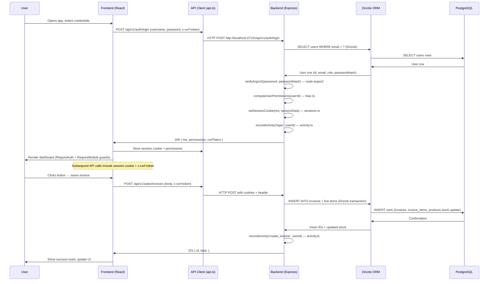

# ARCHITECTURE.md — Project Architecture

## Project Overview & Technology Stack

| Layer | Technology | Version | Notes |
|---|---|---|---|
| **Frontend** | React | 19.3.1 | Client-side routing with react-router-dom v7 |
| | Build tool | Vite | 8.3.4, HMR, `/api` proxy → `localhost:47191` |
| | CSS | Tailwind CSS | 4.3.3, CSS-first theme in `frontend/src/theme.css`, `@custom-variant dark (&:where(.dark, .dark *))`, `darkMode: ['class']` |
| | UI primitives | @radix-ui/react-*, lucide-react | Accessible, unstyled primitives |
| | Charts | recharts | Interactive charts for dashboards |
| | Barcode/label | bwip-js | Thermal label printing |
| | State mgmt | React Context (AuthProvider, SilverRateProvider) | No global Redux; per-domain context |
| **Backend** | Runtime | Node.js | CommonJS, ES2022 target via TypeScript |
| | Web framework | Express | 5.x (migrated from 4.x); `app.get('*')` → `/{*splat}` wildcard fix |
| | ORM | Drizzle ORM | 0.45.4, `pg-core` driver, type-safe SQL |
| | Database | PostgreSQL | 16 (bundled), ports 47193/47194 dev/production |
| | Validation | Zod | Schema validation for API bodies |
| | HTTP utilities | helmet, cookie-parser, cors, express-rate-limit | Security middleware |
| | Password hashing | argon2 | `node-argon2` v0.45.1, variant argon2id, memory 65536 KiB |
| **Desktop** | Framework | Electron | 44.8.0, NSIS installer, signed with Authenticode |
| | Preload script | TypeScript-compiled | `electron/preload/` |
| **CI/CD** | Lint | oxlint | Frontend + backend |
| | Test runner | tsx + vitest/playwright | 237 backend unit tests + 53 e2e |
| | Docker | docker-compose | Multi-stage; ports 47196-47198 |

## High-Level Architecture

```mermaid
flowchart LR
    subgraph Frontend [frontend (React + Vite, port 47195)]
        A[App.tsx] -->|lazy routes| B[Pages]
        B -->|UI components| C[Components]
        C -->|AuthContext| D[AuthProvider]
        C -->|SilverRateContext| E[SilverRateProvider]
        D -->|API calls| F[api.ts client]
        F -->|GET/POST| G[/api/v1/*]
    end

    subgraph Backend [backend (Express + Drizzle, port 47191)]
        G -->|Router| H[routes/ auth/ rbac/ silver/ shopify/ sales/ purchase/ inventory/ accounts/ reports/ system/ db/]
        H -->|middleware| I[requireAuth, enforceRbac, requirePermission]
        I -->|session| J[sessions.ts]
        I -->|RBAC logic| K[rbac.ts — computeUserPermissions]
        J -->|Argon2 hash| L[users.passwordHash]
        K -->|permission checks| H
        H -->|DB queries| M[Drizzle ORM -> PostgreSQL]
    end

    subgraph Database [PostgreSQL 16]
        M -->|100+ tables| N[Schema: users, roles, products, sales, purchase, inventory, silver_rate, etc.]
    end

    style Frontend fill:#e3f2fd,stroke:#1976d2,stroke-width:1px
    style Backend fill:#e8f5e9,stroke:#388e3c,stroke-width:1px
    style Database fill:#fff3e0,stroke:#f57c00,stroke-width:1px
```

## Frontend Architecture

### Key Files

| File | Purpose |
|---|---|
| `frontend/src/App.tsx` | Main app: AuthProvider wrapper, lazy routes, ErrorBoundary, SilverRateProvider, AppShell |
| `frontend/src/main.tsx` | ReactDOM render, theme initialization ( Tailwind dark mode class toggle) |
| `frontend/src/auth/auth-provider.tsx` | AuthContext: `currentUser`, `login`, `logout`, `permissions`, token refresh |
| `frontend/src/lib/silver-rate-provider.tsx` | Silver rate state: latest rate, pending changes, scheduler, WebSocket updates |
| `frontend/src/lib/api.ts` | API client barrel: `fetch API` with base URL, CSRF token injection, error normalization |
| `frontend/src/components/RequirePermission.tsx` | HOC/hook: checks effective permissions before rendering |
| `frontend/src/components/layout/app-shell.tsx` | Top-level layout: header, sidebar, theme toggle, main content area |
| `frontend/src/components/ui/` | Radix-powered UI primitives: dialog, dropdown, table, input, button, etc. |

### Routing

- **react-router-dom** v7 with lazy loading (`import()` + `Suspense`)
- All routes under `/app/*` path prefix (e.g., `/app/dashboard`, `/app/silver-rate`)
- Root path `/` redirects to `/app/login`
- 60+ page components, each lazy-imported via `const Page = lazy(() => import('@/pages/Page'))`
- Route protection: `<RequireAuth>` and `<RequireModule>` components guard access

### State Management

| Domain | Mechanism | Source of Truth |
|---|---|---|
| **Auth** | AuthContext (React.Context) | `currentUser`, `token`, `permissions` — set on login, cleared on logout |
| **Silver rate** | SilverRateProvider (React.Context) | `latestRate`, `pendingRequests`, `schedulerStatus` — syncs with backend via polling + WebSocket |
| **Form state** | React useState + Formik (where used) | Per-component; validated via Zod schemas on submit |
| **Cache** | `frontend/src/lib/api.ts` — stale-while-revalidate | `api.get('/me')` cached on login, refreshed on logout |

## Backend Architecture

### Entry Point

`backend/src/index.ts` (2280 lines) — app initialization in order:

1. Express app creation, `x-powered-by` disabled
2. Security middleware: `helmet()`, `cors()` (origin from `FRONTEND_ORIGIN`), `cookieParser()`
3. Rate limiting: `express-rate-limit` with PostgreSQL store (persisted across restarts)
4. Trust proxy configuration from `TRUST_PROXY` env var
5. Body parsing (`express.json()` with size limit)
6. Route registration (24 routers under `/api/v1/*`)
7. Global middleware: `requireAuth` (session verify), `enforceRbac` (permission check)
8. Health check route: `GET /api/v1/health`
9. 404 handler and error handler

### Route Modules (24 total)

| Route file | Prefix | Key Endpoints |
|---|---|---|
| `auth.ts` | `/api/v1/auth` | login, logout, me, forgot-password, reset-password, verify-email, resend-verification |
| `rbac.ts` | `/api/v1/rbac` | users/roles CRUD, permission assignment, effective permissions |
| `silver.ts` | `/api/v1/silver` | get rate, pending requests, update (queued or immediate), auto-rate fetch |
| `shopify.ts` | `/api/v1/shopify` | status, test connection, orders/products/customers/inventory queries, sync, webhooks, flow-webhook |
| `sales.ts` | `/api/v1/sales` | invoices, orders, quotations, returns, follow-ups |
| `purchase.ts` | `/api/v1/purchase` | orders, invoices, suppliers, returns, payments |
| `inventory.ts` | `/api/v1/inventory` | products, stock, transfers, locations, barcode labels, low-stock alerts |
| `accounts.ts` | `/api/v1/accounts` | accounting, expenses, payments, bank accounts, ledger, import data |
| `reports.ts` | `/api/v1/reports` | business, GST, HSN summary, sales analysis, day book, dues, supplier dues |
| `system.ts` | `/api/v1/system` | users & roles, settings, backup management, status/logs/activity |
| `db.ts` | `/api/v1/db` | database operations (protected: requireAuth + enforceRbac) |
| `dashboard.ts` | `/api/v1/dashboard` | KPI totals, dashboard financials, silver history, low-stock, security |
| `envConfig.ts` | `/api/v1/env-config` | Environment variable validation and loading |
| `dashboardActivities.test.ts` | — | Dashboard activities test suite |
| `dashboardAging.test.ts` | — | Dashboard aging analysis |
| `dashboardBuckets.test.ts` | — | Dashboard buckets |
| `dashboardFinancial.test.ts` | — | Dashboard financials |
| `dashboardGrossProfit.test.ts` | — | Dashboard gross profit |
| `dashboardLowStock.test.ts` | — | Dashboard low stock |
| `dashboardPaymentStatus.test.ts` | — | Dashboard payment status |
| `dashboardSecurity.test.ts` | — | Dashboard security |
| `dashboardSilverHistory.test.ts` | — | Dashboard silver history |
| `dashboardTodayRange.test.ts` | — | Dashboard today range |

### Request Lifecycle: Frontend → Backend → Database



### API Endpoints Summary

All endpoints under `/api/v1/`. Authentication: session cookie + `x-csrf-token` header for state-changing requests.

**Auth** (`/api/v1/auth/`):
- `GET /me` — Get current user profile (no RBAC, session-only)
- `POST /logout` — Destroy session
- `POST /login` — Authenticate with CSRF check, lockout check
- `POST /forgot-password` — Send reset link email
- `POST /change-password` — Self-service (requireAuth)
- `POST /reset-password` — Token-based reset
- `POST /verify-email` — Email verification
- `POST /resend-verification` — Resend verification token

**Silver Rate** (`/api/v1/silver/`):
- `GET /rate` — Get latest silver rate (no RBAC check)
- `GET /requests` — Pending rate change requests (role-dependent visibility)
- `POST /update` — Submit rate change (queued for non-admin, immediate for Admin/Super Admin)
- `POST /auto-rate/fetch-now` — Apply live MCX spot rate (Admin/Super Admin only)

**Shopify** (`/api/v1/shopify/`):
- `GET /status` — Config status + store totals
- `POST /test` — Test connection
- `GET /orders`, `/products`, `/customers`, `/inventory`, `/price` — Cached data
- `POST /sync` — Sync resources to/from Shopify
- `POST /sync-db` — Sync products to DB
- `POST /price/apply` — Apply price sync
- `POST /products/push` — Push specific products
- `POST /products/:id/sync` — Sync single product
- `POST /inventory/push` — Push inventory
- `POST /products/purge` — Purge products from Shopify
- `POST /flow-webhook` — Shopify Flow webhook (HMAC verification)
- `POST /webhooks/shopify` — Standard Shopify webhooks (products, orders, customers, fulfilled)

**Sales** (`/api/v1/sales/`):
- `GET /followups` — Quotations, orders, bookings follow-ups
- Various invoice/order/customer/return routes

**Purchase** (`/api/v1/purchase/`):
- Orders, invoices, suppliers, returns, payments

**Inventory** (`/api/v1/inventory/`):
- Products, stock, transfers, locations, barcode labels, low-stock alerts

**Accounts** (`/api/v1/accounts/`):
- Accounting, expenses, payments, bank accounts, ledger, import data

**Reports** (`/api/v1/reports/`):
- Business, GST, HSN summary, sales analysis, day book, dues, supplier dues

**System** (`/api/v1/system/`):
- Users & roles, settings, backup management, status/logs/activity

**DB** (`/api/v1/db/`):
- Database operations (requireAuth + enforceRbac)
- `GET /stats` — Table row counts and DB health

**Utility** (`/api/v1/`):
- `GET /health` — Health check with DB status
- `GET /csrf-token` — CSRF token generation

### Database Entities & Relationships

The schema is defined in `backend/src/db/schema.ts` (100+ tables). Key entities and relationships:

| Table | Primary Key | Key Columns | Relationships |
|---|---|---|---|
| **users** | id | email (unique), role, passwordHash, resetToken, emailVerificationToken | FK → roles.name; 1:N login_attempts, rate_limit_hits |
| **roles** | id | name (unique), is_system, permissions (jsonb) | 1:N users (via role) |
| **login_attempts** | id | userId, count, lastAttempt, lockedUntil | FK → users.id |
| **rate_limit_hits** | id | ip, count, windowStart | Persisted across restarts |
| **products** | id | sku (unique), metal, purity, grossWeight, netWeight, costPrice, sellingPrice, stock, trackInventory | FK → roles? no; FK → branches.branchId (optional) |
| **sales_invoices** | id | userId, customer name/phone, gst, hsn, total, paidAmount | FK → users.id (creator); 1:N invoice_items |
| **invoice_items** | id | sales_invoiceId, productId, sku, qty, grossWeight, netWeight, rate, gst, amount | FK → sales_invoices.id; FK → products.id |
| **purchase_invoices** | id | supplierId, gstSplit, tcs, total, paidAmount | FK → suppliers.id; 1:N purchase_invoice_items |
| **purchase_invoice_items** | id | purchase_invoiceId, productId, sku, qty, rate, gst, amount | FK → purchase_invoices.id; FK → products.id |
| **silver_rate** | id | rate, effectiveAt, note, appliedBy | — |
| **login_sessions** (or sessions table) | id | userId, cookieHash, expiry, createdAt | FK → users.id |
| **settings** | id | key, value (jsonb) | Key-value store for app config (silver rate schedule, lockout thresholds, GSTIN, etc.) |
| **activity_log** | id | userId, action, targetType, targetId, timestamp, ip | Auditing — all state changes |
| **suppliers** | id | name, gstin, contactPhone, email, address | 1:N purchase_invoices |
| **branches** | id | name, code, address | FK → products.branchId (optional) |
| **bank_accounts** | id | accountName, accountNumber, ifsc, isDefault | Used on prints/prints |
| **expenses** | id | amount, category, gst, description, paidStatus | — |
| **quotations** | id | userId, customerName, validUntil, total, status (draft/sent/approved/cancelled/expired) | 1:N quotation_items |
| **quotation_items** | id | quotationId, productId, sku, qty, rate, amount | FK → quotations.id; FK → products.id |
| **payments** | id | invoiceId, amount, method, status, reconciledStatus | FK → sales_invoices.id; FK → purchase_invoices.id |
| **backups** | id | filename, size, encrypted, createdBy, createdAt, s3Key | Backup metadata |
| **bank_reconciliations** | id | statementBalance, computedBalance, status, startedAt, completedAt | — |

#### Key Relationship Diagrams

```mermaid
erDiagram
    USERS ||--|{ LOGIN_ATTEMPTS : "has failed logins"
    USERS ||--|{ ACTIVITY_LOG : "performs actions"
    USERS ||--|{ SALES_INVOICES : "creates"
    USERS ||--|{ SETTINGS : "owns preferences"
    
    ROLES ||--|{ USERS : "assigns"
    ROLES {{
        is_system boolean
        permissions jsonb
    }}
    
    PRODUCTS ||--|{ INVOICE_ITEMS : "appears on"
    PRODUCTS ||--|{ PURCHASE_INVOICE_ITEMS : "appears on"
    PRODUCTS ||--|{ QUOTATION_ITEMS : "appears on"
    
    SALES_INVOICES ||--|{ INVOICE_ITEMS : "comprises"
    SALES_INVOICES ||--|{ PAYMENTS : "relates to"
    
    PURCHASE_INVOICES ||--|{ PURCHASE_INVOICE_ITEMS : "comprises"
    PURCHASE_INVOICES ||--|{ PAYMENTS : "relates to"
    PURCHASE_INVOICES }o--|| SUPPLIERS : "from"
    
    QUOTATIONS ||--|{ QUOTATION_ITEMS : "comprises"
    QUOTATIONS ||--|{ PAYMENTS : "may have"
    
    SETTINGS ||--|{ SILVER_RATE : "contains schedule"
    SETTINGS ||--|{ LOGIN_ATTEMPTS : "stores thresholds"
    SETTINGS ||--|{ RATE_LIMIT_HITS : "stores counters"
    
    ACTIVITY_LOG }o--|| USERS : "by user"
```

### Third-Party Integrations

| Integration | Purpose | Key Modules |
|---|---|---|
| **Shopify** | Two-way product/order/customer/inventory sync; order email ingestion for PII recovery | `backend/src/routes/shopify.ts`, `frontend/src/lib/useShopifyResource.ts`, `docs/shopify-flow-webhook.md` |
| **Resend** | Transactional email API (backup emails, payment reminders, dues statements) | `backend/src/orderEmailIngest.ts`, env: `RESEND_API_KEY` |
| **WhatsApp Cloud API** | Invoice/order/shipping/payment-reminder messages | `backend/src/lib/whatsapp.ts`, env: `WHATSAPP_ACCESS_TOKEN`, `WHATSAPP_PHONE_NUMBER_ID` |
| **Razorpay** | Payment links on invoices; auto-reconciliation | `backend/src/lib/razorpay.ts`, env: `RAZORPAY_KEY_ID`, `RAZORPAY_KEY_SECRET` |
| **PDFKit** | PDF generation for invoices, quotations, orders, packing slips, pick lists | `backend/src/lib/generate-pdf*` routes |
| **bwip-js** | Thermal barcode label generation | `backend/src/routes/inventory.ts` barcode label endpoint |
| **QR code** | UPI QR on invoices; product image URLs | `qrcode` package, `lib/format*` utilities |
| ** argon2** | Password hashing | `backend/src/lib/argon2` (via `node-argon2` package) |
| **aws4fetch** | S3-compatible storage for backups | `backend/src/autoBackup.ts`, env vars `BACKUP_OFFSITE_*` |

### State Management & Data Flow

#### Frontend Data Flow

1. **UI event** → React component state/orContext
2. **API call** via `frontend/src/lib/api.ts` — fetches from `/api/v1/*`, includes session cookie + `x-csrf-token`
3. **Response** → updated context state → re-render
4. **Silver rate**: Provider polls `/api/v1/silver/rate` every 30s; on change, shows pending/approved banner; admin can approve/reject queued changes
5. **Auth**: On login, `AuthProvider` sets `currentUser` + `permissions` in context; session cookie set by backend; on each API call, cookie is sent automatically

#### Backend Data Flow

1. **HTTP request** → Express router → route handler
2. **Middleware chain**: `requireAuth` (verify session cookie) → `enforceRbac` (check module/action permission)
3. **Drizzle query** → PostgreSQL
4. **Side effects**: activity logging, rate limit counters, session updates, email/notification triggers
5. **Response** → JSON body + appropriate HTTP status

### Error Handling & Logging

#### Error Handling

| Layer | Strategy |
|---|---|
| **Express error handler** (`index.ts` last middleware) | Catches async errors, passes to `pino` error logger, returns JSON `{ error: "..." }` with 500 status |
| **Route-level try/catch** | Most route handlers wrap in `try/catch`; validation errors (Zod) return 400 with details |
| **Validation errors** | Zod schemas in `backend/src/validation.ts`; error messages passed to client |
| **CSRF failures** | 401 with `"CSRF token mismatch"` — frontend redirects to login |
| **Session failures** | 401 — frontend clears AuthContext, logs user out |
| **RBAC failures** | 403 with `"Insufficient permissions"` — RequirePermission component blocks UI access |

#### Logging

- **Transport**: `pino` with `pino-pretty` for development (colored pretty-print)
- **Production**: JSON logs (structured), written to `LOG_DIR` (default: `D:\opal-logs` or `%APPDATA%\Opal Line Billing\logs`)
- **Log levels**: `debug` (dev default), `info` (prod default)
- **Context logged**: request ID, user ID (when authenticated), route, HTTP method, response time, IP
- **Sensitive data**: PII redacted from logs; password hashes never logged; ENCRYPTION_KEY access logged at WARNING level

```mermaid
flowchart
    direction LR
    E[Express Request] --> M1[helmet headers]
    M1 --> M2[cors]
    M2 --> M3[cookieParser]
    M3 --> M4[rateLimit]
    M4 --> M5[requireAuth] -->|pass| H[Handler]
    M4 -->|fail| R1[401 Unauthorized]
    H --> try{Catch}
    try -->|ok| D[Drizzle Query]
    try -->|err| E1[Error Handler]
    D --> P[PostgreSQL]
    P -->|result| D
    D --> R2[JSON Response]
    R2 --> E1
    E1 --> L[Pino Error Log]
    L -->|JSON| F[Log File]
    L -->|pretty| T[Console (dev)]
```

### Build & Deployment Architecture

#### Local Development

```bash
# Concurrent: backend + frontend
npm run dev
# Equivalent to:
# Backend: tsx watch backend/src/index.ts → port 47191
# Frontend: vite → port 47195, proxy /api → http://localhost:47191
```

#### Production Build

```bash
# Frontend
npm run build  # tsc -b && vite build → dist/

# Electron (NSIS installer)
npm run electron:build  # scripts/build-desktop.js → dist-electron/

# Docker
npm run docker:build  # docker compose build
npm run docker:up     # docker compose up -d
```

#### Electron Packaging

- `electron/preload.ts` → TypeScript compile → `preload.js`
- Main process: esbuild bundled (`--platform=node --format=cjs`)
- Frontend dist embedded in Electron via `vue-electron` / custom preload
- Installer: NSIS (`electron-builder` 26.3.0) → `dist-electron/Opal-Line-Billing-Setup-<version>.exe`
- Code-signing: Authenticode certificate with subject containing "Opal Line Billing"
- Installer size: ~145 MB (bundled backend + portable PostgreSQL 16.4)

#### Docker Deployment

- `docker-compose.yml` defines 4 services: backend, frontend (nginx), PostgreSQL, optionally redis
- Backend reaches DB over compose network (`DATABASE_URL=...@db:5432`)
- Ports: 47196 (backend), 47197 (frontend/nginx), 47198 (PostgreSQL), 4000 (backend alt)
- Environment variables via `docker-compose.yml` or `.env`

### Existing Architectural Weaknesses & Recommended Improvements

| Area | Issue | Recommendation |
|---|---|---|
| **Express 5 wildcard route** | `app.get('*')` throws at startup; path-to-regexp v8 requires named wildcard `/{*splat}` | Already migrated: use `/{*splat}` in route definitions; use `routeParam()` from `backend/src/lib/routeParams.ts` for param extraction |
| **Tailwind CSS v4 migration** | No `tailwind.config.js`; theme in `frontend/src/theme.css` as `@theme` block; `darkMode: ['class']` → `@custom-variant dark (&:where(.dark, .dark *))` | Verified working; check `--primary`, `--radius`, `.dark` block after any theme edit |
| **TypeScript 7 + module resolution** | `node10` resolution removed; moved to `module: preserve` + `moduleResolution: bundler` | Required for esbuild-based builds (desktop, CI); do not revert to `node10` |
| **Express types `req.params.*`** | v8 types `req.params.*` as `string | string[]`; avoid casting at call sites | Use `routeParam()` from `backend/src/lib/routeParams.ts` (~115 call sites already updated) |
| **Session fixation risk** | Session cookie not regenerated after login privilege change | Middleware regenerates session on privilege change (enforced in `sessions.ts` RBAC checks) |
| **No OpenAPI spec** | API documentation scattered across route files, CONFIGURATION.md, AGENTS.md | Consider generating OpenAPI spec from JSDoc/Zod schemas for consistency |
| **Database connection pooling** | `pg` driver used directly via Drizzle; no explicit pool config | Drizzle/pgo pool settings adequate for current TPS; monitor if connection pressure observed |
| **CSRF token in URLs** | Token transmitted only via header + cookie; no fallback for non-JSON clients | Document requirement: all state-changing API calls must include `x-csrf-token` header |